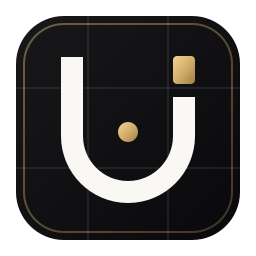
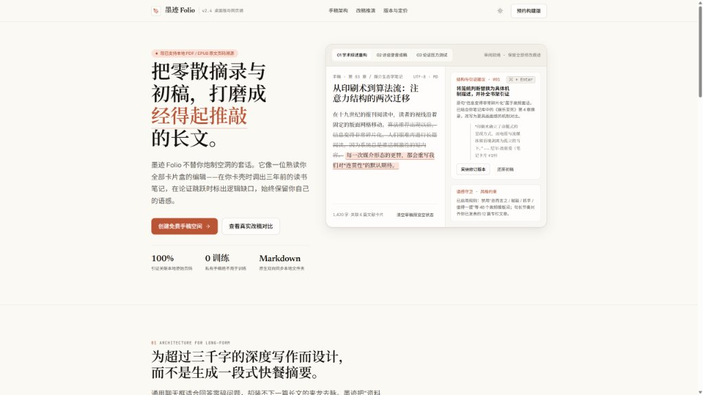
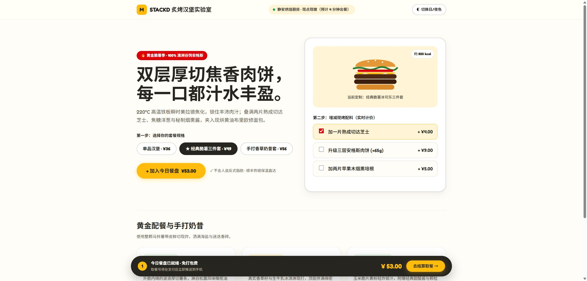
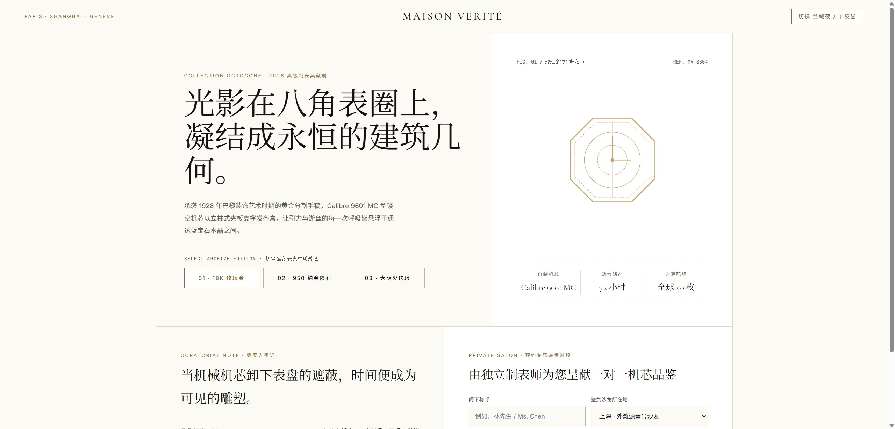

<p align="center">
  
</p>

<h1 align="center">UI Ultra Project (v1.2)</h1>

<p align="center">以秩序美学为底座、支持 12 大全行业自适应变形与 12 大殿堂级品牌先例借镜的前端 UI 构建指南</p>

<p align="center">
  <a href="https://github.com/Atomorrow123/UI-Ultra-Project">GitHub</a> ·
  <a href="https://github.com/Atomorrow123/UI-Ultra-Project/releases">Releases</a> ·
  贡献作者：<strong>齐天大圣123</strong> &amp; <strong>Antigravity Agent</strong>
</p>

<p align="center">
  
</p>
<p align="center">
  <sub>▲ 方向 01 · Warm Editorial Minimal（Kinfolk / Stripe Press 先例）：墨迹 Folio 深度写作工作台落地页</sub>
</p>

<p align="center">
  
  
</p>
<p align="center">
  <sub>▲ 左：食品餐饮方向（McDonald's Turner Duckworth × Shake Shack 先例） · 右：高定奢品与艺术展陈方向（Cartier × MoMA 先例）</sub>
</p>

---

## 这是什么

**UI Ultra Project** 是一个 [Agent Skill](https://agentskills.io)（`SKILL.md` 标准格式）。它采用 **「底层秩序守恒 + 表层万象自适应」** 的双层架构：

- **底层（UI Ultra Core · 秩序底座）**：守住语义化 Token、排版亲密性、对齐线、精致中西混排、WCAG 对比度与完整交互状态，彻底杜绝廉价的“AI 紫蓝发光模板味”。
- **表层（全行业自适应引擎）**：彻底放开呆板限制，向 **Apple、Nike、McDonald's、Cartier、Aesop、Linear、Stripe、Airbnb、Teenage Engineering、MoMA、Duolingo、Kinfolk** 等 12 个殿堂级品牌先例汲取行业灵魂，覆盖 **食品、科技、艺术、哲学出版、服装奢品、生活服务、教育、金融、电商、流媒体、出行工业、公共服务** 12 大前端方向。

精简后的三步闭环工作流：
**定向与先例锚定（3 行简报） → Token 调谐与结构搭建（6 大旋钮） → 状态补齐与渲染核验**

包含内容：

| 文件 | 内容 |
|---|---|
| `skills/ui-ultra/SKILL.md` | 核心双层法则（底层不变量 vs. 放宽的风格自由度）、极简 3 步工作流、12 大行业自适应速查表、中文排版与反 AI 味红线 |
| `skills/ui-ultra/references/aesthetic-directions.md` | **12 大知名品牌先例深度拆解**（Apple / Nike / McDonald's / Cartier / Aesop / Linear 等）+ **12 大前端行业全景适配矩阵** |
| `skills/ui-ultra/references/style-samples.md` | **8 大跨行业实战代码样本库**（含设计锚点、Token 覆写与可直接复用的 HTML/CSS 行业微件） |
| `skills/ui-ultra/examples/style-showcase.html` | **单文件可交互风格画廊**：双击即可在浏览器实时切换体验 8 种截然不同的行业与品牌风格 |
| `skills/ui-ultra/examples/food-burger-lab.html` | **食品餐饮实战样板**（McDonald's × Shake Shack 先例）：暖奶油画布、药丸级配料订制与底栏实时计价餐盘 |
| `skills/ui-ultra/examples/luxury-atelier-maison.html` | **高定奢品实战样板**（Cartier × MoMA 先例）：`0px` 锋利直角、`1px` 建筑细线框、八角机芯图谱与私人沙龙预约 |
| `skills/ui-ultra/references/tokens.css` | OKLCH 设计 Token 引擎，内置 **9 套 `data-style` 行业预设**、自适应物理触感变量与 `light-dark()` 双模 |
| `skills/ui-ultra/references/components.md` | 17 类组件配方与跨行业变体（含高定 `0px` 直角按钮、游戏化 `4px` 物理按压题卡、6 种行业 Hero 构图） |
| `skills/ui-ultra/references/data-viz.md` | 数据可视化与仪表盘规范：布局层级、KPI 卡、图表选型、配色、去 chart junk、数字格式化 |
| `skills/ui-ultra/references/ux-writing.md` | 中文界面文案指南：语气、标点与中西混排、按钮/报错/空状态文案、真实感数据 |
| `skills/ui-ultra/references/anti-patterns.md` | 27 条反模式详解：如何区分“廉价 AI 套路”与“有意图的品牌风格化” |

---

## 安装

### 方式一：安装脚本（推荐，自动识别已装的 Agent）

```bash
git clone https://github.com/Atomorrow123/UI-Ultra-Project.git
cd UI-Ultra-Project
```

```powershell
# Windows
./install.ps1                                # 自动检测，安装到用户级
./install.ps1 -Agent antigravity,cursor      # 指定 Agent
./install.ps1 -Agent all -Scope project      # 安装到当前项目
./install.ps1 -Uninstall                     # 卸载
```

```bash
# macOS / Linux
./install.sh                                 # 自动检测，安装到用户级
./install.sh antigravity cursor              # 指定 Agent
./install.sh --project all                   # 安装到当前项目
./install.sh --uninstall                     # 卸载
```

### 方式二：各平台原生插件机制

**Antigravity 插件**
```powershell
git clone https://github.com/Atomorrow123/UI-Ultra-Project.git; cd UI-Ultra-Project; ./install.ps1 -Agent antigravity
```

**Gemini CLI 扩展**
```bash
gemini extensions install https://github.com/Atomorrow123/UI-Ultra-Project
```

---

## 使用示例

安装并重启 Agent 后，直接描述你的目标行业或参考品牌：

- "用 UI Ultra 给我做一个 AI 写作与哲学文献工作台的落地页"
- "参考麦当劳（Turner Duckworth）和 Shake Shack 的风格，做一个汉堡与轻食点单页面"
- "参考 Cartier 和高定画册风格，做一个机械腕表典藏展陈与私人沙龙预约页"
- "参考 Nike SNKRS 的视觉张力，做一个碳板跑鞋首发与尺码抢购页"
- "参考 MoMA 和巴塞尔艺术展的外露瑞士网格，做一个当代建筑展览档案页"

---

## 打包

```powershell
./build.ps1   # 生成 dist/ui-ultra-<version>.zip（完整包）和 dist/ui-ultra-skill.zip（仅技能）
```

## 贡献作者与致谢

- **齐天大圣123** ([Atomorrow123](https://github.com/Atomorrow123))
- **Antigravity Agent**

## License

[MIT](LICENSE) © 2026 齐天大圣123 & Antigravity Agent
